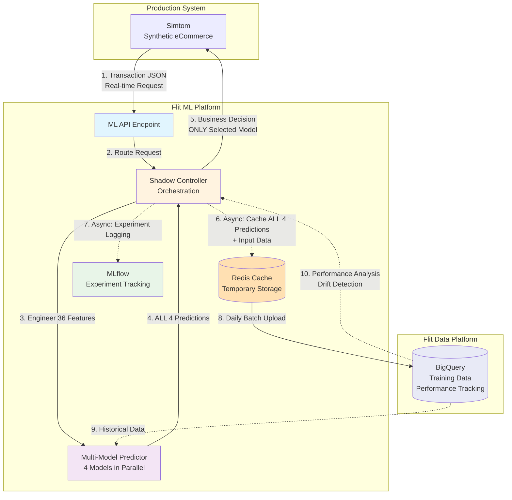

# Flit ML Platform

Production-grade machine learning infrastructure for eCommerce intelligence, built with modern MLOps practices and designed for operational resilience.

## Platform Overview

Flit ML is a scalable ML platform that addresses critical business decisions across the eCommerce lifecycle. The platform architecture separates model development, experiment management, and production deployment to enable rapid iteration while maintaining production stability.

### Current Capabilities

| Project | Status | Business Impact | Technical Stack |
|---------|--------|-----------------|-----------------|
| **BNPL Risk Assessment** | Production (Railway) | Real-time credit decisioning | Shadow Mode A/B Testing, MLflow, Redis |
| Demand Forecasting | Planned | Inventory optimization | - |
| Marketing Optimization | Planned | Customer acquisition efficiency | - |

### Architecture Philosophy

The platform implements three-layer separation of concerns that enables independent optimization of ML inference, deployment strategies, and business integration:

**Data Layer**: Integrates with `flit-data-engineering` for feature engineering pipelines and `simtom` synthetic data generation for production-like testing environments.

**ML Layer**: Model training, experiment tracking (MLflow), and multi-model inference with sub-millisecond latency requirements.

**Deployment Layer**: Shadow mode controller orchestrates A/B testing, experiment management, and business rule integration without impacting API response times.

## System Integration



### Production Infrastructure

**Deployment**: Railway platform with containerized microservices
**Storage**: Redis caching (real-time) + BigQuery (analytics)
**Monitoring**: MLflow experiment tracking with async logging
**Testing**: Shadow mode deployment enables safe production testing

## Projects

### BNPL Risk Assessment

Production ML system for real-time Buy Now Pay Later credit decisions. Implements sophisticated A/B testing infrastructure with 4 production models (Ridge, Logistic, Elastic Net, Voting Ensemble) achieving 0.616 AUC while maintaining <20ms API response times.

**Key Technical Achievements:**
- Shadow mode controller with storage abstraction for operational flexibility
- Deterministic traffic assignment using customer ID hashing for consistent experiments
- Async operation design maintains sub-20ms response times while logging comprehensive metrics
- Railway deployment with Redis co-location for sub-millisecond caching operations

**Documentation:**
- [Project Overview](docs/projects/bnpl/README.md) - Complete BNPL implementation journey
- [Shadow Controller Design](docs/architecture/shadow_mode_controller.md) - A/B testing architecture
- [ML Data Infrastructure](docs/architecture/ml_data_infrastructure.md) - Production data flow
- [Known Issues](docs/models/bnpl0925_known_issues.md) - Model limitations and future improvements

**Performance Characteristics:**
- API Response: <20ms (target: <100ms)
- Model Inference: ~2ms (4 models)
- Feature Engineering: ~15ms
- Redis Operations: <1ms

**Current Status:** Deployed on Railway with ephemeral MLflow tracking. Phase 3 roadmap includes persistent MLflow server, BigQuery analytics integration, and advanced monitoring dashboards.

### Future Projects

**Demand Forecasting**: ML-driven inventory optimization and delivery resource planning. Transferable to supply chain management and logistics optimization across industries.

**Marketing Optimization**: Customer acquisition cost reduction through predictive LTV modeling and channel attribution. Applicable to any digital marketing operation with multi-channel customer acquisition.

## Technology Stack

**ML Framework**: scikit-learn (production models), MLflow (experiment tracking)
**API Framework**: FastAPI with async operation support
**Data Processing**: pandas, NumPy with BigQuery integration
**Deployment**: Docker containers on Railway platform
**Storage**: Redis (caching), BigQuery (analytics), MLflow (artifacts - SQLite ephemeral, PostgreSQL planned)
**Testing**: pytest with comprehensive unit/integration coverage

## Development

### Quick Start

```bash
# Install dependencies
poetry install

# Setup development environment
cp .env.redis.template .env.redis
# Edit .env.redis with local Redis credentials

# Run test suite
poetry run pytest -v

# Start API locally
poetry run uvicorn flit_ml.api.main:app --reload
```

### Testing Strategy

```bash
# Run all tests (organized by category)
python run_tests.py

# Specific test suites
poetry run pytest tests/unit/ -v          # Unit tests
poetry run pytest tests/integration/ -v   # Integration tests

# Individual modules
python tests/unit/features/test_feature_engineering.py
python tests/unit/models/test_multi_model_predictor.py
```

### Code Quality

```bash
# Linting and type checking
poetry run ruff check .
poetry run mypy .
```

## Repository Structure

```
flit-ml/
├── flit_ml/                    # Core ML platform code
│   ├── api/                    # FastAPI service endpoints
│   ├── config/                 # Configuration management (BigQuery, etc.)
│   ├── core/                   # Shadow controller, Redis storage, registry
│   ├── data/                   # Data access layer
│   ├── evaluation/             # Model evaluation frameworks
│   ├── features/               # Feature engineering pipelines
│   ├── models/                 # Model implementations by project
│   │   ├── bnpl/              # BNPL-specific models
│   │   └── shared/            # Shared model utilities
│   └── monitoring/             # Observability and monitoring
├── docs/
│   ├── architecture/           # Platform architecture decisions
│   ├── data/                   # Data schema and lineage
│   ├── deployment/             # Deployment guides
│   ├── models/                 # Model artifacts and known issues
│   └── projects/               # Project-specific documentation
│       └── bnpl/              # BNPL technical deep dive
├── tests/
│   ├── unit/                   # Component-level tests
│   │   ├── api/
│   │   ├── core/
│   │   ├── features/
│   │   └── models/
│   └── integration/            # End-to-end workflow tests
├── models/                     # Trained model artifacts
│   └── production/            # Production-ready models (.joblib files)
├── research/                   # ML research and experimentation
│   ├── experiments/            # MLflow experiments
│   ├── notebooks/              # Jupyter notebooks
│   └── reports/                # Research findings
├── scripts/                    # Deployment and utility scripts
├── Dockerfile                  # Railway deployment configuration
├── railway.json               # Railway platform config
└── run_tests.py               # Organized test runner
```

## Data Integration

### Training Data Pipeline

**Source**: BigQuery (flit-data-platform)
- Models trained on historical data in BigQuery tables
- `flit_intermediate.int_bnpl_customer_tenure_adjusted`: Primary training dataset (1.9M records)
- Model retraining uses accumulated prediction data for drift correction and performance optimization

**Feature Engineering**: Batch processing in BigQuery → 36 engineered features → Model training

### Live Inference Pipeline

**Source**: Simtom (production synthetic eCommerce system)
- Real-time API calls with transaction JSON
- **No database access during inference** - <2ms latency requirement
- Feature engineering happens in-memory from API request data

**Flow**:
1. Simtom sends transaction → ML API receives JSON
2. Shadow Controller engineers 36 features in-memory
3. ALL 4 models generate predictions (~2ms)
4. Selected model's decision returned to Simtom
5. **Post-inference**: ALL 4 predictions + input data cached to Redis (async, non-blocking)

### Data Storage for Monitoring

**Redis**: Temporary cache for inference results (30-day TTL)
- Stores ALL 4 model predictions for every transaction
- Input features and metadata
- Business decisions and experiment assignments

**BigQuery**: Long-term analytics and model monitoring
- Daily batch upload from Redis
- Model performance tracking
- Data drift detection
- Ground truth joining for retraining

## Deployment

### Production Environment

Current deployment on Railway platform with managed Redis for caching:

```bash
# Deploy to Railway (automatic from git push)
git push origin main

# Manual deployment validation
curl https://flit-ml-api.railway.app/health
```

Detailed deployment instructions: [DEPLOYMENT.md](DEPLOYMENT.md)

### Environment Configuration

Production environments require:
- `REDIS_URL`: Managed Redis connection string
- `BIGQUERY_PROJECT`: GCP project ID for data access
- `MLFLOW_TRACKING_URI`: MLflow server endpoint (coming in Phase 3)

See [.env.production.template](.env.production.template) for complete configuration.

## Roadmap

### Phase 3: MLOps Maturity (Next)
- Persistent MLflow server deployment (Railway + PostgreSQL)
- BigQuery integration for long-term analytics
- Comprehensive production monitoring dashboards
- Automated model performance analysis

### Phase 4: Advanced Capabilities
- Model registry with automated champion selection
- Real-time drift detection and alerting
- Load testing and performance optimization
- Multi-armed bandit experiment optimization

### Future Projects
- Demand forecasting for inventory and delivery optimization
- Marketing optimization with LTV prediction
- Customer churn prediction
- Price optimization models

## Documentation

**Project Documentation**: [docs/projects/](docs/projects/) - Complete technical details per project
**Architecture Decisions**: [docs/architecture/](docs/architecture/) - Platform design and trade-offs
**Model Artifacts**: [docs/models/](docs/models/) - Production model documentation
**Deployment Guide**: [DEPLOYMENT.md](DEPLOYMENT.md) - Production deployment procedures

## Contributing

Development follows trunk-based workflow with feature branches:
1. Create feature branch from `main`
2. Implement changes with comprehensive testing
3. Create PR with detailed technical documentation
4. Deploy to production after review and merge

## License

[MIT License](LICENSE)

---

**Platform Maintainer**: Kevin | [GitHub](https://github.com/whitehackr/flit-ml)
**Documentation Standards**: See [CLAUDE.md](CLAUDE.md) for technical documentation requirements
